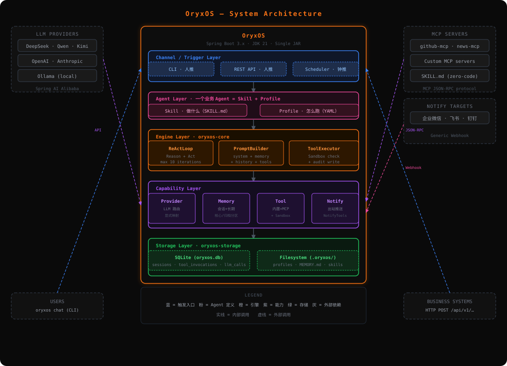

<p align="center">
  
</p>

<p align="center">
  <strong>一句话说清要做什么，Agent 就在你自己的服务器上跑起来。</strong><br/>
  <em>Java 原生、企业自托管的 Agent OS（Agent Harness OS）。</em>
</p>

<p align="center">
  
  
  <a href="https://modelcontextprotocol.io"></a>
  
</p>

---

**OryxOS 是企业自托管的 Agent OS。** 它把「Agent 定义 + 模型路由 + 工具执行 + 记忆 + 通知 + 定时调度 + 沙箱 + 审计」收敛成一个单进程底座，装在企业自己的 K8s / 服务器上，多个业务 Agent 共享同一套能力，数据不出内网。

- **今天已经跑通的（单节点运行时内核）**：一个目录就是一个 Agent —— `.oryxos/agents/<name>/AGENT.md` 丢进工作区即热加载上线；自实现 ReAct 循环、10 个内置工具、MCP 接入、长期记忆、Webhook 通知、Cron 定时、四维白名单沙箱、三层审计落库、REST API、Web 管理台，全部打在一个 fat JAR 里。
- **北极星（尚未实现）**：一句话提交任务，由一组 Agent（规划 / 执行 / 复核）自组织协作交付。见[路线图](#路线图)。

> 本文档描述 **0.1.0-SNAPSHOT 的实际实现**。与 `docs/` 下早期规划文档冲突时，以代码为准。
> 第一次使用？直接看 [使用指南](docs/GettingStarted.md)：构建、配置、启动、跑通第一个 Agent。

## Agent 公式

Agent 需要的东西都在 OS 里，Agent 只负责"引用"：

```text
AGENT.md（一段自然语言指令 + 少量配置）
  + Provider 路由          + 工具（内置 10 个 / MCP）
  + 长期记忆 MEMORY.md      + 通知渠道（Webhook）
  + 定时调度 Cron           + 沙箱与审计
= 一个能在自己服务器上跑的 Agent
```

核心目标是**把定义一个 Agent 的成本压到接近零**：你写意图，OS 提供能力、护栏和审计。

## 什么是 Agent Harness（为什么是 OS）

**Agent Harness 是套在模型外面、把模型变成"能干活的 Agent"的那层脚手架**：驱动 reason → act → observe 的循环、可调用的工具及其执行、每次调用前拼装的上下文、积累下来的记忆、关住它的沙箱、以及记录它干了什么的审计轨迹。裸模型只会产出文本，是这层脚手架让它能**可靠、安全地做事**。

> 生产环境里 Agent 的瓶颈通常不是模型，而是模型外面那层脚手架。而企业从来不止跑一个 Agent。

OryxOS 给每个 Agent 同一套生产级脚手架，并像操作系统管理进程那样管理这一群 Agent —— 这就是 **Agent Harness OS**。

| | 裸模型 | Agent Harness | Agent Harness OS |
| --- | --- | --- | --- |
| 范围 | 一次 LLM 调用 | **一个**可靠的 Agent | **一群** Agent |
| 提供 | 文本生成 | 循环、工具与执行、上下文、记忆、沙箱、审计、投递 | 生命周期、接入渠道、路由、共享注册表、调度、治理、管理台与 API |
| 类比 | 一条 CPU 指令 | 一个带运行时的进程 | 管理多进程的操作系统 |

OryxOS 是第三列，同时把它下面的第二列，交付给每一个它运行的 Agent。

## 特性

**一个目录 = 一个 Agent**
Agent 就是一个目录：`.oryxos/agents/<name>/AGENT.md` —— YAML frontmatter（模型、工具、通知、定时等配置）+ 正文任务指令。同目录下可选的 `REFERENCE.md`、`skills/`、`scripts/`、`memory/` 按需加载。目录名就是 Agent 名、注册键与会话维度。多个 Agent 共存于同一个实例。

**动态管理，无需重启**
REST 可直接创建 / 查询 / 覆盖 / 归档 Agent；`generate-files` 能把一句话描述交给模型草拟 `AGENT.md`；直接往工作区丢目录也行 —— `WorkspaceWatcher` 监听 `agents/`，300ms 去抖后热注册。坏目录不会拖垮实例：启动扫描失败的目录只跳过自己、原因写进启动日志；运行期改动失败的会进 `skipped`（`GET /api/v1/agents`）并保留原有注册。

**单二进制，零外部依赖**
一个 fat JAR 同时是 CLI 与服务端：REST API、Web 管理台、调度器、沙箱在一个进程里，同步执行跑在 Java 21 虚拟线程上。不需要额外的运行时、sidecar 或前端进程。

**私有与合规**
跑在你自己的 K8s、虚机或裸金属上；数据、记忆、审计库全部留在本地。密钥只走 `${ENV_VAR}` 占位，配置与代码里不出现明文，`GET /providers` 也绝不返回 api-key。

**显式 Provider 映射**
`oryxos.providers[]` 声明本实例接了哪些模型服务，`provider name → ChatModel` 的映射是显式的（不靠扫描 Bean 类型），Agent 只引用 name，不感知具体厂商。`GET /providers` 会把"配了但没装配出来"的部署错误标成 `not-assembled`。

**安全即地基**
有副作用的工具调用（文件 / 命令 / HTTP / 通知）都要过白名单：文件路径、命令、出站域名、脚本解释器四个维度，任一清单为空即该维度全部拒绝。审计从第一天就落库：每次 Agent 运行、每次 LLM 调用、每次工具调用都进表，成功失败都记。

**开放标准**
工具走 MCP（`mcp_servers.yaml` 配置即接入，stdio / sse 两种 transport），Agent 之间协作规划走 A2A（路线图）。

## 架构

<p align="center">
  
</p>

OryxOS 是一个 Spring Boot 单体应用，单二进制部署。自外向内四层，外部依赖清晰隔离：

| 层 | 职责 | 关键模块 |
| --- | --- | --- |
| **接入层** | 消息进出：CLI、REST、定时触发三个入口 | `oryxos-cli`、`oryxos-web`、`AgentScheduler` |
| **引擎层** | Agent 大脑：ReAct 循环、Prompt 组装、工具执行、生命周期 | `oryxos-core`（`ReActLoop` / `PromptBuilder` / `ToolExecutor` / `AgentLifecycleService`） |
| **能力层** | 供养引擎的四块能力 | `oryxos-provider`、`oryxos-memory`、`oryxos-tool`（工具 + MCP + 通知 + 沙箱） |
| **基础层** | 工程地基：工作区与注册表、持久化与审计 | `oryxos-core`（`AgentLoader` / `WorkspaceWatcher`）、`oryxos-storage` |

两个要点：

- 所有能力收敛到**一个引擎、一套存储、一个进程**，符合"单二进制、装好就跑"的定位。
- 引擎与能力之间通过**抽象接口解耦**（`LlmClient`、`MemoryService`、`OryxTool`、`SessionStore`、审计接口），扩展新 Provider / Tool 时不动核心引擎。

外部依赖（模型厂商 API、外部 MCP Server）都在应用边界之外，OryxOS 不绑定任何一家。

## 五大核心能力

| 能力 | 说明 |
| --- | --- |
| **① 对接 LLM** | 全局配置声明 Provider + 显式 `name → ChatModel` 映射；Agent 通过 `provider.name` 引用，换模型只改配置（重启生效） |
| **② ReAct 循环** | 自实现：LLM 决定是否调工具、调哪个，OryxOS 执行并把结果回填，LLM 再决定下一步。默认 `max_iterations=10`，全流程同步、可观测、可中断 |
| **③ Memory** | 长期记忆是 `MEMORY.md`（`## 核心记忆` 常驻 + `## 归档记忆` 可检索/截断）：工作区共享一份，目录 Agent 另有 `<agentDir>/memory/MEMORY.md`。`save_memory` / `recall_memory` 读写，每轮自动注入 system prompt；会话历史由 `SessionManager` 独立承担 |
| **④ Tool 体系** | 内置 10 个工具（文件 / 命令 / HTTP / 通知 / 记忆 / 演示天气）；扩展两条路：MCP server（复用或自写），或实现 `OryxTool` 并注册为 Spring Bean |
| **⑤ Web Service** | 全部能力经 REST 暴露（`/api/v1/**`），配 React 管理台；业务系统用任何语言都能 HTTP 集成 |

## 能力边界（当前不做）

核心阶段刻意不做，避免"看起来支持、实际半成品"：

- 多 Agent 任务委托 / A2A 协作、流式（SSE）响应
- 认证鉴权（假定内网部署）、多租户、SSO/RBAC、Tool Policy 治理
- 向量检索、知识库、情景记忆（记忆仅有文件 + 关键词检索）
- IM Channel（企业微信 / 飞书 / 钉钉 / Slack）
- 容器级沙箱（当前是应用层白名单；不使用已废弃的 SecurityManager）
- 并行工具调用（同一轮内多个工具按顺序执行）
- Provider / 通知渠道的运行时增删改（Provider 只有只读 API，通知渠道写在各 Agent 配置里；改配置需重启）
- 沙箱白名单的 REST 修改（只读展示；改配置需重启）
- 分布式调度与无状态多实例（调度在单节点内存中）

## 路线图

**Phase 1 — 单节点运行时内核** ✅ *已交付*
一句话或一个目录定义一个 Agent，热加载即上线；记忆、10 个内置工具、MCP、通知、Cron、沙箱、完整审计、REST API、Web 管理台全部可用。

**下一步（并行推进，按需取用）**

- **分布式地基**：存储可插拔（SQLite → MySQL/PostgreSQL）、无状态实例、基于 DB 的集群调度
- **知识与记忆**：内置知识库 + 语义记忆，共享向量子系统
- **流程编排**：声明式流程、Sub-agent 委托、A2A 协议
- **自进化 Agent**：从成功运行中沉淀技能
- **全渠道与多模态**：IM 渠道、语音、浏览器、视觉
- **容器级沙箱**：Docker / SSH 执行后端
- **企业治理**：多租户、SSO/RBAC、成本看板、审计查询与报表
- **人机协同**：危险操作人工审批、成本治理、智能模型路由
- **北极星**：一句话提交任务，Agent 团队自组织交付

## 模块结构

9 个 Maven 模块，职责单一、按接口解耦：

```text
oryxos-core          # ReActLoop、PromptBuilder、ToolExecutor、AgentLoader/WorkspaceWatcher、
                     # AgentScheduler、Session、Profile、OryxTool、MemoryService 接口、审计接口
oryxos-provider      # ProviderService、显式 provider→ChatModel 映射、Function Calling 适配
oryxos-memory        # DefaultMemoryService、LongTermMemory、MemoryFiles、MemoryTools
oryxos-tool          # 内置工具（file/shell/http/notify/weather）、MCP Client、ToolRegistry、Sandbox
oryxos-storage       # SQLite：sessions / agent_runs / llm_calls / tool_invocations
oryxos-web           # REST 控制器、管理台静态资源、GlobalExceptionHandler、统一错误体
oryxos-channel-cli   # CLI Channel（oryxos chat 的实现）
oryxos-cli           # Picocli 入口（9 个顶层子命令）、工作区布局
oryxos-boot          # Spring Boot 启动、自动装配、打成 fat JAR
```

前端源码不在 Maven 模块里：`admin-web/` 是管理台（React 18 + Vite 5），构建产物落到 `oryxos-web/src/main/resources/static/admin/`，随 JAR 一起发布。

## 快速开始

**环境要求**：JDK 21+、Maven 3.9+、一个模型服务的 API Key（DeepSeek / Kimi / OpenAI 兼容端点均可）。管理台已预构建，**不需要**全局安装 Node.js。

### 1 · 构建

```bash
git clone <repo-url> oryxos
cd oryxos
mvn -DskipTests package
# 产物: oryxos-boot/target/oryxos-boot-0.1.0-SNAPSHOT.jar
```

### 2 · 配好密钥

```bash
cp config/application.yml.example config/application.yml   # Windows: copy config\application.yml.example config\application.yml

# Linux / macOS
export DEEPSEEK_API_KEY=sk-xxxx
# Windows PowerShell
$env:DEEPSEEK_API_KEY="sk-xxxx"
```

`config/application.yml` 已在 `.gitignore` 中，不会被提交；Spring Boot 会优先加载它，覆盖 JAR 内打包的 `oryxos-boot/src/main/resources/application.yaml`，**改配置不需要重新打包**。

- `oryxos.providers[]`：本实例接的 Provider（`name` / `base-url` / `api-key`）。`api-key` 写成 `${DEEPSEEK_API_KEY}` 占位，不落明文。
- `oryxos.author.provider` / `oryxos.author.model`：「一句话生成 AGENT.md」和新建 Agent 模板用的模型。**未配置时该功能返回 503，其余功能不受影响。**
- `oryxos.sandbox.*`：四维白名单（见[沙箱与安全](#沙箱与安全)）。**留空即拒绝**，第一次跑文件 / shell / HTTP 工具前要先配。

完整参数说明与排错见 [使用指南](docs/GettingStarted.md)。

### 3 · 初始化工作区

```bash
# Windows
bin\oryxos.cmd init
# Linux / macOS / 任意平台
java -jar oryxos-boot/target/oryxos-boot-0.1.0-SNAPSHOT.jar init
```

初始化会在启动目录下建 `.oryxos/`：

```text
.oryxos/
  agents/<name>/AGENT.md   # 目录 Agent（主路径；首次建 Agent 时创建）
  archive/<name>-<时间戳>/  # DELETE /agents/{name} 的归档去向（不物理删除）
  profiles/*.yaml          # legacy Profile（仍兼容，改完需重启）
  memory/MEMORY.md         # 工作区共享长期记忆
  skills/  sessions/  logs/  tools/
  mcp_servers.yaml         # MCP server 声明
  AGENTS.md  SOUL.md  USER.md
  oryxos.db                # SQLite：会话 + 审计
```

工作区默认是 `<启动目录>/.oryxos`。运行时可用 `oryxos.workspace` 指向别处；CLI 轻命令读的是系统属性 `-Doryxos.workspace=<基目录>`，并在其下再建 `.oryxos/`。

想立刻试一个现成 Agent（无需重启）：

```bash
cp -r examples/agents/weather-get .oryxos/agents/       # Windows: xcopy /E /I examples\agents\weather-get .oryxos\agents\weather-get
```

### 4 · 启动

```bash
# 一键起服务：REST API + 管理台（同一端口）
bin\oryxos.cmd serve --port 8080        # Linux/macOS: ./bin/oryxos.sh serve --port 8080

# 或者先跟 Agent 聊一句（默认 profile 为 default）
bin\oryxos.cmd chat
```

> `bin/oryxos.cmd` 是 Windows 便捷包装，默认 JDK 21 与 JAR 路径按本机环境写死；用 `ORYXOS_JAVA_HOME`、`ORYXOS_JAR`、`ORYXOS_JAVA_OPTS` 覆盖。

### 常用命令

| 命令 | 说明 |
| --- | --- |
| `oryxos init` | 初始化 `.oryxos/` 工作区 |
| `oryxos status` | 打印工作区路径与 legacy Profile 数量（不启动 Spring） |
| `oryxos chat [--profile\|-p <name>]` | 交互式多轮对话，默认 `default` |
| `oryxos serve [--port <port>]` | 启动 HTTP 服务（默认 8080），REST + 管理台 |
| `oryxos gateway` | 常驻守护模式（不启 Web 容器），由调度等后台触发驱动 |
| `oryxos profile list\|create\|show\|delete` | legacy Profile 管理（`default` 不可删） |
| `oryxos provider list` | 已装配的 Provider |
| `oryxos tool list` | 真实注册表里的工具（含 MCP 工具） |
| `oryxos session list` | 会话存储概览（当前打印 SQLite 路径） |

`chat` / `serve` / `gateway` / `tool` 需要完整运行时；`init` / `status` / `profile` / `provider` / `session` 是轻命令，秒回。

## Web 服务与管理台

`serve` 让一个进程同时提供两个门面：

| URL | 内容 |
| --- | --- |
| `http://localhost:8080/api/v1/**` | REST API |
| `http://localhost:8080/admin/` | **Web 管理台**（React 18 + Vite 5） |
| `http://localhost:8080/swagger-ui/index.html` | OpenAPI 文档（springdoc 默认路径，未定制） |

管理台页面：总览、Agent 列表与详情（新建、一句话生成草稿、`AGENT.md` 编辑、管理台会话、独立记忆）、会话与运行明细（每次提问 → LLM 调用 → 工具调用）、定时任务、工具、Provider、沙箱策略概览（开关与各维度条数，不展示清单内容）、工作区文件浏览器、工作区记忆。

### 管理台开发模式（热更新）

改 UI 时不要每次都重打 JAR，用 Vite dev server：

```bash
# 1. 后端先跑起来（dev server 会把 /api 代理过去）
bin\oryxos.cmd serve --port 8080

# 2. 另一个终端
cd admin-web
npm install          # 首次
npm run dev          # http://localhost:5173/admin/
```

dev server 端口 5173，`base=/admin/`，`/api` 代理到 `localhost:8080`（见 `admin-web/vite.config.js`）。改 `src/` 即时生效；完成后 `npm run build` 会把产物写进 `oryxos-web/src/main/resources/static/admin/`，下次 `mvn package` 随 JAR 发布。

## Agent 定义

**一个目录 = 一个 Agent**：`.oryxos/agents/<name>/AGENT.md`，frontmatter 是配置，正文是每轮注入 system prompt 的任务指令。

```markdown
---
description: "温度预警：每分钟取天气，超过 25°C 就推送"
provider:
  name: deepseek          # 必须是 oryxos.providers 里声明过的 name
  model: deepseek-flash
  temperature: 0.3
tools:                    # 未列出的工具该 Agent 调不到
  - get_weather
  - save_memory
  - notify
notify_channels:
  - type: webhook
    config:
      url: http://127.0.0.1:9099/webhook
schedules:
  - id: every-minute      # Agent 内唯一
    cron: "* 9 * * * *"   # 6 段：秒 分 时 日 月 周
    timezone: Asia/Shanghai
    message: 获取当前天气，记录温度；超过 25°C 就推送通知
settings:
  max_iterations: 10
  max_history_turns: 20
  processing_timeout_seconds: 60
  tool_timeout_seconds: 30
---

# 角色

你是一个温度预警 Agent，每分钟获取天气情况并记住结果，超过 25°C 就推送通知。
```

约束与约定：

- **目录名即 Agent 名**，只允许小写字母、数字、中划线，且以字母或数字开头；frontmatter 里写 `name` 只做一致性提示。
- **未知字段直接失败**（防止 `zone:` 这类拼写错误静默失效）；**`skills:` 在 frontmatter 里是硬错误** —— 目录里的 `skills/` 是按需读的资源，与"每轮全量注入"的 `Profile.skills` 不是一回事。
- `identity` 可写字符串，也可写映射（自动展平）；`bootstrap.files` 可显式引用额外的 prompt 文件。

同目录可选内容：

| 内容 | 用途 | 加载方式 |
| --- | --- | --- |
| `AGENT.md` | 配置 + 指令 | 配置启动/变更时解析；正文每轮重读 |
| `REFERENCE.md` | 领域资料 | 路径写进 prompt，模型按需 `read_file` |
| `skills/*.md` | 流程说明 | 按需读取（渐进式披露） |
| `scripts/` | 可执行脚本 | `shell` 工具执行；仅限本目录 + 解释器白名单 |
| `memory/MEMORY.md` | 该 Agent 独立长期记忆 | `save_memory` / `recall_memory` |

热加载边界：新增/删除 Agent 目录、修改 `AGENT.md` 会触发重注册（内容非法则保留旧注册）；legacy `profiles/*.yaml` 没有监听，改完需重启。

创建 Agent 的三种方式：直接建目录、`POST /api/v1/agents`、或在管理台用一句话让模型生成草稿（`POST /api/v1/agents/{name}/generate-files`，只预览不落盘）。

## REST API

所有端点以 `/api/v1` 为前缀，**无鉴权**（核心阶段假定内网）。**没有统一成功信封**：成功直接返回 DTO；失败返回非 2xx + `ErrorBody{errorCode, message, timestamp}`。

| Method | Path | 说明 |
| --- | --- | --- |
| `GET` / `POST` | `/agents` | Agent 列表（含 `skipped` 及原因）/ 创建 |
| `GET` / `PUT` / `DELETE` | `/agents/{name}` | 详情 / 覆盖 `AGENT.md`（先校验后写盘）/ 归档下线 |
| `POST` | `/agents/{name}/invoke` | 无状态单轮调用（一次性会话） |
| `POST` | `/agents/{name}/generate-files` | 一句话 → 草稿 `AGENT.md`（不落盘） |
| `POST` | `/agents/{name}/files` | 保存一组 Agent 文件并使其生效 |
| `GET` | `/agents/{name}/memory` | 该 Agent 的长期记忆（注入视角） |
| `GET` / `POST` | `/agents/{name}/session`、`/agents/{name}/session/messages` | 管理台会话 + 发消息 |
| `POST` | `/agent/chat` | 按 body 指定 profile 的对话（复用会话） |
| `GET` / `POST` | `/sessions` | 会话列表 / 创建 |
| `GET` / `DELETE` | `/sessions/{id}` | 会话摘要与最近消息 / 归档 |
| `POST` | `/sessions/{id}/messages` | 发消息（触发 ReAct 循环） |
| `GET` | `/sessions/{id}/runs` | 运行明细：每次提问 → LLM 调用 → 工具调用 |
| `GET` | `/profiles`、`/profiles/{name}` | Profile / Agent 目录派生出的配置（只读） |
| `GET` | `/providers` | 已声明的 Provider 及装配状态（不含密钥） |
| `GET` | `/tools` | 注册表里的工具（含 MCP 工具） |
| `GET` | `/schedules` | 定时任务快照（只读） |
| `GET` | `/memory` | 工作区长期记忆快照（只读） |
| `GET` | `/workspace/tree`、`/workspace/file` | 工作区目录树 / 读文件 |
| `POST` | `/workspace/file` | 写工作区文件 |
| `GET` | `/health`、`/info` | 健康检查 / 版本、Provider、沙箱概要 |

`/admin`、`/admin/` 重定向到管理台首页。

## 审计与运行时

一次请求会留下三层记录，通过 `run_id` 串起来（`session_id` 关联会话），日志同时经 MDC 带上 `[runId] [sessionId]`：

| 表 | 粒度 | 关键内容 |
| --- | --- | --- |
| `agent_runs` | 一次提问 | 用户消息、profile、provider/model、轮数、工具调用数、token 汇总、终态与失败原因；**两阶段写**（先 INSERT `RUNNING`，结束再 UPDATE），进程中途挂掉也有痕迹 |
| `llm_calls` | 每次 LLM 调用 | 用量、耗时、成败、失败原因 |
| `tool_invocations` | 每次工具调用 | 入参、结果、耗时、成败、失败原因 |

表结构由 `oryxos-storage/src/main/resources/db/schema.sql` 手工维护（`spring.sql.init.mode=always`），列演进脚本在 `db/migration/`；`hibernate.ddl-auto=update` 只作兜底，不要依赖它改表。

## 沙箱与安全

工具执行前一律过应用层白名单（**不用 SecurityManager** —— JDK 21 已不可用），配置在 `oryxos.sandbox`：

| 维度 | 配置键 | 规则 |
| --- | --- | --- |
| 文件 | `allowed-paths` | 按解析后的真实路径判定，`..` 与符号链接绕不过去 |
| 命令 | `allowed-commands` | 命令首个 token 精确匹配，大小写敏感（配 `echo` 则 `ECHO` 被拒） |
| 出站域名 | `allowed-domains` | host 模式（不是 URL），支持 `*`，带标签边界 |
| 脚本解释器 | `allowed-interpreters` | 目录 Agent 的 `scripts/` 只允许这些解释器（默认 `python,python3,py,bash,sh,node`） |

两条纪律：

- **任一清单为空 = 该维度一律拒绝**（默认收紧，放开必须显式配置）。
- `enabled: false` 会让四个维度全部放行，仅限本地调试；生产务必写死 `true`，关闭时启动日志会打出醒目告警。

模型调用走 Provider，不经过域名白名单；密钥只以 `${ENV_VAR}` 形式出现。

## 设计原则

- **平台优先于 Agent** —— 最重要的交付物不是一个强大的 Agent，而是让任何 Agent 都能可靠运行的环境
- **核心自实现** —— 推理循环自己写；协议适配复用成熟库，不重复造轮子
- **一个目录 = 一个 Agent** —— Agent 是目录（`AGENT.md` + 可选资源），不是代码
- **开放标准** —— 工具用 MCP，协作规划用 A2A，技能用开放格式
- **无状态倾向** —— 状态尽早外置到工作区与数据库，为分布式留路
- **安全即地基** —— 受控的工具来源、最小权限、强制沙箱、凭证不落库、审计 day one
- **分阶段有纪律** —— 先做最小完整运行时内核，每次架构升级都由真实使用数据证明

## 技术栈

| 类别 | 选择 |
| --- | --- |
| 语言 / 运行时 | Java 21（虚拟线程） |
| 应用框架 | Spring Boot 3.3.x 单体，fat JAR 部署 |
| LLM 适配 | Spring AI 1.1.x（OpenAI 兼容连接器 + 协议转换 + Tool Schema）；依赖管理引入 Spring AI Alibaba BOM |
| Agent 循环 | 自实现 ReAct（`ReActLoop` + `ToolExecutor`），**禁用**框架的自动 tool 执行 |
| HTTP 层 | Spring MVC + 虚拟线程 |
| 命令行 | Picocli |
| 配置 | Spring Boot YAML + SnakeYAML（Agent frontmatter） |
| 持久化 | SQLite（`sqlite-jdbc` + Spring Data JPA + Hibernate Community Dialect） |
| MCP | MCP Java SDK 0.8.x |
| 前端 | React 18 + Vite 5（`admin-web/`） |
| 文档 | springdoc-openapi |
| 日志 | Logback + SLF4J（带 `runId` / `sessionId` MDC） |

## 文档

| 文档 | 说明 |
| --- | --- |
| [使用指南](docs/GettingStarted.md) | 从构建、配置密钥到跑通第一个 Agent 的完整步骤（含排错） |
| [业界调研](docs/industryResearch.md) | Agent OS 领域现状、OryxOS 定位与愿景 |
| [需求文档](docs/DemandAnalysis.md) | 功能与非功能需求（What） |
| [技术方案](docs/TechnicalSolution.md) | 技术选型与架构设计（How） |
| [AI 编程实施](docs/AIProgrammingGuide.md) | Spec-Kit 混合模式开发思路 |
| [实现讲解系列](docs/class/) | 按模块逐节讲原理与代码（Provider / ReAct / CLI / Notify / Tool / Memory / Sandbox / 调度 / Web / 插件化 Agent / 动态管理） |
| [开发指导](AGENTS.md) | 供 AI 编程助手与开发者遵守的工程约束 |
| [架构图](website/public/images/architecture.svg) | 架构图源文件（另见 `docs/images/`） |

> `docs/` 下四份文档写于规划阶段，部分细节（Profile 体系、工具数量、端点数量、实施节奏）已被实现超越；README 与代码是当前事实来源。

## 许可证

仓库目前**未包含 LICENSE 文件**，许可证待定。在补齐许可证之前，请勿对外分发或商用。
