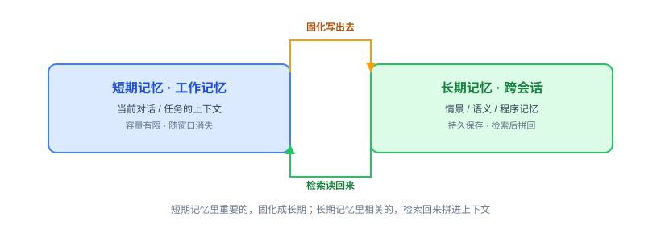
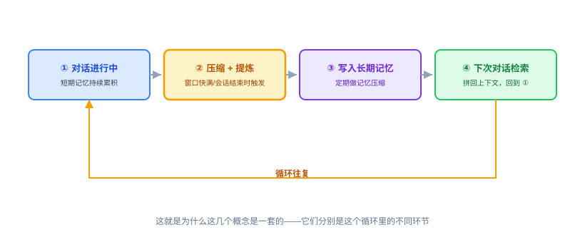
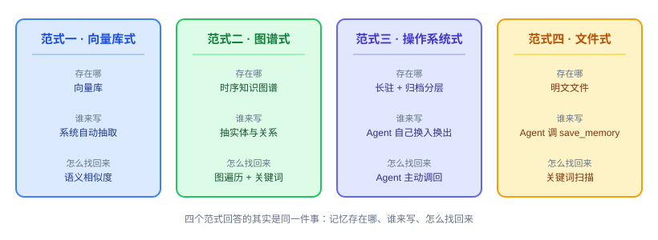
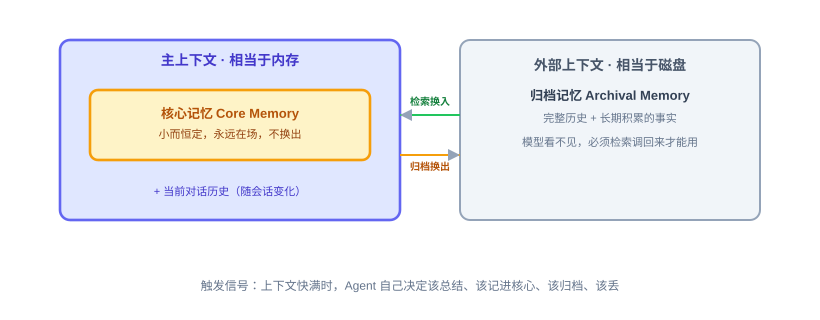
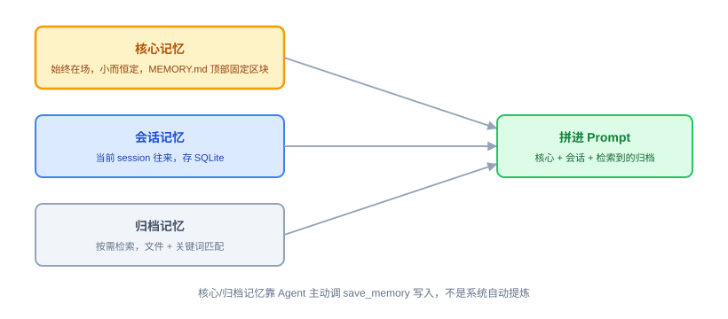
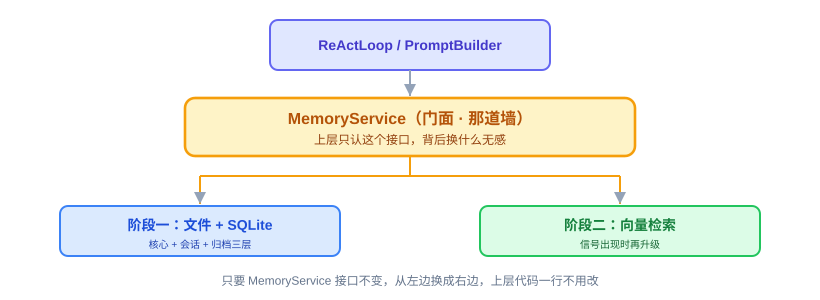

# Memory：原理解析、业界方案与 OryxOS 设计评审

Provider、ReAct、CLI、Notify、Tool 都讲完了，Agent 能被喂话、会想、会动手、会往外推消息。这节讲 Memory，解决的是另一个缺口：Agent 记不记得住事。这节不写代码（代码实现是下一节的事），是一次技术评审：把 Memory 是什么、业界怎么做讲清楚，再给出 OryxOS 的设计结论。

---

## 第一部分：Memory 是什么，业界怎么做

### 一、为什么 Agent 需要 Memory

**大模型本身不记事，但 Agent 要干活必须记事，这个矛盾逼出了 Memory。**

大语言模型每一次调用都是无状态的——它不记得上一次说过什么，全靠调用方把历史塞进上下文窗口。但 Agent 要多轮对话、要跨会话记住用户、要执行长任务，就必须记得住东西。而上下文窗口有限且昂贵，token 越多越慢越贵，还有硬上限。所以 Agent Memory 的本质是：**在有限的上下文窗口之外，管理一套让 Agent 记得住东西的机制。**

这件事在 2026 年被推到台前，原因很直接：它是 Agent 从 Demo 到生产要跨的头号坎之一。一个 Agent 周一能通过全部评测，周三却忘了用户的名字——这不是模型问题，是记忆问题。Demo 能跑，是因为整段对话塞得进一个上下文窗口；生产会崩，是因为真实用户会跨会话、跨天、跨话题地回来。

### 二、短期记忆与长期记忆

**短期记忆是这一次对话的"工作台"，长期记忆是跨会话的"仓库"。**

**短期记忆**（也叫工作记忆）就是当前这次对话或任务的上下文，对应的其实就是当前塞在上下文窗口里的内容：本轮对话历史、刚调用工具的结果、当前任务的中间状态。特点是容量有限、生命周期短、访问快。对话结束或窗口满了，它就没了。

**长期记忆**是跨会话、跨时间持久保存的东西。用户上周说过喜欢用某种语言、项目叫什么，这次对话还记得，这就是长期记忆。它不在上下文窗口里，而是存在外部，需要用的时候再检索出来、拼回上下文。长期记忆内部通常还会借用认知科学的说法再细分三类：**情景记忆**（具体发生过的事，比如上次讨论过什么、结论是什么）、**语义记忆**（抽象的事实和知识，比如用户偏好、项目背景）、**程序记忆**（怎么做某件事的流程，有时沉淀成技能或规则）。

两者之间有一个核心循环：短期记忆里重要的东西，会被固化成长期记忆写出去；长期记忆里相关的东西，用时被检索回短期记忆拼进上下文。

### 三、两个容易混的概念：上下文压缩 vs 记忆压缩

**上下文压缩管"当下这轮说的话"，记忆压缩管"存下来的仓库"，作用的层面完全不同。**

**上下文压缩**，解决的是当前对话太长、窗口快塞满的问题。手段是把已有上下文变短，比如把前面很多轮对话总结成一段摘要，或者把不重要的部分裁掉。它作用在**当前这次交互**的层面，目的是让对话能继续下去不爆窗口。

**记忆压缩**，解决的是长期记忆越存越多、检索越来越低效的问题。手段是把积累的大量记忆做归并、去重、抽象，把多条相关的记忆合并成一条更概括的，把过时的淘汰掉。它作用在**长期记忆库**的层面，目的是让记忆库保持精炼、可用。

一句话区分：上下文压缩是把现在说的话压短，管的是当下的窗口；记忆压缩是把存下来的东西整理精简，管的是长期的仓库。

### 四、记忆提炼：长期记忆能用起来的关键一步

**原始对话是啰嗦的，不提炼直接存，长期记忆库就是垃圾堆。**

原始对话啰嗦、口语化、含大量无关信息，不可能原样存进长期记忆——占空间、检索还不准。所以需要**提炼**：从一段对话或一次任务里，抽取出值得长期记住的东西，加工成结构化、精炼的记忆条目。比如从一段含糊的表达里，提炼出一条干净的记忆："用户在性能敏感场景偏好某种技术选型"。

提炼通常靠模型自己来做，让它读完对话输出哪些该记，也可以配合规则。**提炼的质量直接决定长期记忆的质量**：提炼得准，检索才有用；提炼得烂，记忆库就是垃圾堆。

### 五、把这些概念串成一个完整循环

**对话累积、压缩提炼、写入归档、定期精简、检索拼回——这是一个闭环，转起来才是一个活的记忆系统。**

### 六、业界怎么做：主流方案详解

**先给一把尺子再看货架：不看谁 star 多，只看它怎么回答三个问题——记忆存在哪、谁来写、怎么找回来。**

2026 年，记忆已经从"Agent 的一个功能"长成了独立赛道。把外壳剥掉，这些方案的差别只落在三个设计点上：

| 设计点 | 常见的几种答案 |
|---|---|
| 记忆存在哪 | 向量库 / 知识图谱 / 关系库 / 明文文件 |
| 谁来写 | 系统自动抽取（模型在后台当清洁工）/ Agent 自己动手（模型调工具）/ 人手动写 |
| 怎么找回来 | 语义相似度 / 关键词 / 图遍历 / 不检索，全量带在上下文里 |

按这三个点归类，主流方案其实只有四个范式。

**范式一，向量库式（RAG 式）——把记忆当文档检索。**
这是最朴素、也最普遍的做法：把对话切片、算向量、存进向量库，用时按相似度召回。优点是实现成本最低，随便一个向量库都能当记忆层，所以"给 Agent 加记忆"的教程八成到这里就结束了。短板在结构上：记忆之间没有关系、没有时间，只记"说过什么"，不表达"什么变了"；去重和更新全靠上层自己填。结果是同一条事实改了口径之后，库里并存两条互相矛盾的记忆，谁也说不清哪条算数。**它解决的是"找得到"，不是"记得住"。**

**范式二，图谱式——把记忆当关系网络（时序知识图谱）。**
代表是 Zep / Graphiti，它把进系统的信息组织成三层子图：**情节**（原始输入：消息、文本、JSON）、**语义**（抽出来的实体与关系）、**社区**（实体聚类后的摘要），三层之间可互相索引。关键设计是**双时态**：每条关系同时记"事实发生的时间"和"系统记录它的时间"，一条事实失效时不删除，而是把它的有效区间关掉——于是记忆里天然保留了"某个时间点我们以为是什么样"。检索也不走单一路径，而是语义 + 关键词 + 图遍历混合召回再重排。代价很实在：写入要抽实体和关系，慢且贵，还得养一个图库。**它适合"事实会随时间变化"的业务**——客户状态、项目演进、谁跟谁是什么关系。

**范式三，操作系统式——把记忆当虚拟内存管理。**
代表是 Letta（前身 MemGPT）：一小块永远在场的长驻记忆，加上外部的归档记忆，模型自己调工具在两者之间换入换出，上下文快满时主动整理。它和前面两个范式的着力点完全不同——**前两个优化的是"怎么找回来"，它优化的是"当下这个窗口里该放什么"**。代价是整理质量取决于模型能力，而且你基本等于把 Agent 运行时一并交给了它。第七节单独解剖。

**范式四，文件式——把记忆当明文文档。**
代表是 Anthropic 的 memory tool（客户端直接读写 `/memories` 目录）、Claude Code 的 `CLAUDE.md`、ReMe，以及 OryxOS 自己。它的优势不在检索，而在**透明**：明文可读、可 diff、可 review、可手改、可进版本库，排查问题时不用问"库里那条记忆长什么样"，打开文件就是；零外部依赖，天然跨重启。短板同样清楚：量一大，关键词匹配就抓不住"换了个说法但意思相同"的记忆（语义鸿沟），也表达不了关系。**它最适合记忆量中小、又极其看重可审计可干预的场景——单机、私有部署、企业内网，正好是 OryxOS 核心阶段的场景。**

**另外还有一支主要活在论文里、但值得知道的一派：让记忆自己演化。**
它们把"记忆的组织"从检索问题升级成了结构问题，三个代表：

- **A-MEM**：借卡片笔记法（Zettelkasten），每条记忆是一张结构化卡片；新卡片进来先和旧卡片建链接，再**反向更新旧卡片的标签与上下文**——记忆库自己长大、自己改自己。
- **MemoryOS**：把记忆分热 / 温 / 冷三层，按"热度"淘汰和升级，等于把操作系统的分页思想搬到记忆上。
- **MemOS**：把记忆当成可调度的资源（MemCube），定位是"记忆的操作系统"。

这一派今天的价值是方向提示，不是工程选项：它们指向的是**记忆的自我组织**，那是记忆量真正变大之后才需要操心的问题。

**逐个点名：主流项目速写。** 把四个范式落到具体项目上，每个方案的"存在哪 / 谁来写 / 怎么找"是这样：

| 项目 | 定位 | 机制速写 |
|---|---|---|
| Mem0 | 即插即用的记忆层（是库，不是运行时） | 两阶段管线：**抽取 + 更新**。先用模型从对话里抽出候选事实，再和库里已有记忆逐条比对，决定 ADD / UPDATE / DELETE / NOOP；事实进向量库、关系可选进图库，两边并行写入；作用域分 user / session / agent |
| Zep / Graphiti | 时序知识图谱记忆 | 三层子图（情节 / 语义 / 社区）+ 双时态，事实失效是关掉有效区间而不是删除；检索为语义 + 关键词 + 图遍历混合重排；LongMemEval 上（GPT-4o）约 63.8%，Mem0 约 49% |
| Letta（前身 MemGPT） | 有状态 Agent 运行时 | 长驻记忆块 + 归档记忆 + 历史检索，模型自己调工具编辑记忆，上下文压力触发整理；还有"睡眠期"在对话间隙做记忆沉淀（下节详谈） |
| Cognee | 图原生、自改进的记忆管线 | ECL 管线：Extract 抽结构化信息 → Cognify 建图与本体 → Load 入库；memify 再做记忆的精炼与再组织；支持十余种检索模式 |
| LangMem | LangGraph 生态的官方记忆 | 两条路径：热路径（对话中直接读写）+ 后台（对话后异步提炼）；分语义 / 情景 / 程序三类记忆，还能把经验固化成提示词 |
| Memobase | 面向产品的用户画像记忆 | 结构化用户画像 + 事件时间线，带显著性衰减（越久不用的记忆权重越低），落关系库 |
| ReMe | 透明的文件式记忆 | 以文件系统为记忆载体，配提炼与整理的工作流 |
| 官方内置（ChatGPT / Claude） | 大厂自带的记忆 | ChatGPT 走"保存的记忆 + 引用历史对话"，后台异步做记忆合成；Anthropic 的 memory tool 走文件路线 |
| 框架自带（LangGraph Store / LlamaIndex / CrewAI） | 生态绑定的朴素记忆 | 多为"向量库 + 命名空间"的薄封装，换框架就得重写 |

Mem0 和 LangMem 这两个尤其值得对照着看：**同一个"存哪"的答案（都是向量库），"谁来写"却相反**——Mem0 是系统在后台自动抽取，LangMem 还额外给了热路径让 Agent 自己动手。这说明选型的真正分水岭不在存储介质，在写入权归谁。

**四个范式摆在一起比一比：**

| | 向量库式 | 图谱式 | 操作系统式 | 文件式 |
|---|---|---|---|---|
| 记忆存在哪 | 向量库 | 时序知识图谱 | 长驻 + 归档分层 | 明文文件 |
| 谁来写 | 系统自动抽取 | 系统自动抽取 | Agent 自己 | Agent 或人 |
| 怎么找回来 | 语义相似度 | 图遍历 + 关键词 + 语义 | Agent 主动调回 | 关键词扫描 / 全量注入 |
| 实现成本 | 低（但要多引一个向量库） | 高（图库 + 抽取管线） | 中高（要一套自管理机制） | 极低（零依赖） |
| 强在哪 | 语义召回，量大也能用 | 关系和时间，"事实会变"表达得出来 | 当下窗口永远可控，记忆会自己整理 | 透明、可读、可 diff、可审计、可手改 |
| 弱在哪 | 无关系、无时间，容易攒出互相矛盾的记忆 | 写入慢且贵，运维重 | 依赖模型能力，绑定了运行时 | 量大后关键词召回不准 |
| 典型场景 | 文档型问答 | 客户 / 项目状态随时间变化 | 长期陪伴型 Agent | 私有部署、可信可控 |

几个概念在这些项目里的落地对应关系：**记忆提炼**对应各家的自动抽取能力，Cognee 的 cognify 管线就是干这个；**记忆压缩与自改进**对应 Cognee 的 memify、Letta 的自主管理；**上下文压缩**更多在 Agent 框架层，记忆框架反而管得少，因为它们的思路是"与其压上下文，不如把该外置的外置出去"。

一个重要判断：**LongMemEval** 已经成为这个领域的事实标准压力测试，同一批任务上不同架构能差到 15 分。这说明记忆不是"有没有"的问题，而是**架构选型**的问题——选错范式，后面堆多少工程都补不回来。

**最后，这一圈看下来，OryxOS 该学什么、不该背什么。** 四点：

1. **拿三个设计点去评估任何方案，而不是记产品名。** 存哪 / 谁写 / 怎么找，答不清楚就说明它没想清楚；这也正是我们阶段一选"文件式 + 关键词"的依据——三件事都有明确答案。
2. **写入权交给 Agent，比系统自动抽取更适合我们。** Mem0 那种自动抽取很省心，但"什么算重要"是模型在后台悄悄决定的，业务方看不见也改不了；OryxOS 面向私有部署，要可控可审计，让 Agent 明确调 `save_memory` 说清楚"该不该记"，是更合定位的选择，还省掉一次模型调用。
3. **"事实会变"这件事，用最土的办法也要表达出来。** 图谱式的双时态给了一个洞察：旧事实不该删除，而该被标记为失效。阶段一的文件式用"追加新记录 + 标注旧记录失效"就能拿到八成好处，不必为此背一个图库。
4. **把生态当参照系，不当待办清单。** 看一眼就知道别人在卷什么、我们暂时不卷什么；是否升级仍由第十一节的三个信号决定，而不是由别人发了新版本决定。

### 七、重点解剖：MemGPT 的"记忆即 OS"

四个范式里，操作系统式这一支和 OryxOS 的定位最近——它琢磨的正是"一个有限窗口的 Agent 该怎么记住事"。这里单独解剖。

**LLM 的上下文窗口像内存，外部存储像磁盘，MemGPT 借操作系统的虚拟内存管理来管 Agent 的记忆。**

Letta 的前身 MemGPT 值得单独讲，因为它的思想和 OryxOS 做 Agent OS 最同源。核心洞察来自一个类比：LLM 的上下文窗口就像计算机的内存，快、贵、但小；外部存储就像磁盘，慢、便宜、但几乎无限。操作系统当年用虚拟内存解决过一模一样的问题——用分页机制在内存和磁盘之间自动换入换出，让程序感觉自己有无限内存。MemGPT 说，那我们能不能像操作系统管理虚拟内存那样，来管理 LLM 的上下文。

它把记忆明确分成两层：**主上下文**相当于内存，是当前塞进窗口的内容，其中有一块**核心记忆**，是最重要、要一直带在身上的信息，小而精，永远在场不换出；**外部上下文**相当于磁盘，放归档记忆和完整历史，放不进或不常用的东西存到外面，用时检索。区别在于主上下文里的东西模型直接看得见，外部的看不见，必须调回来才能用。

MemGPT 最精妙的一步，是**把记忆管理的控制权交给 Agent 自己**。它给 Agent 提供一组操作自己记忆的工具，比如把重要信息写进核心记忆、把过时的改掉、把当前上下文归档、从归档检索。当上下文快满了，系统给 Agent 一个类似"内存压力"的信号，Agent 收到后自己决定哪些该总结、哪些该写进核心记忆、哪些该归档、哪些可以丢。用操作系统的话说，MemGPT 让 Agent 扮演了"管理自己虚拟内存的进程"这个角色。

这套思想里，有两个点对 OryxOS 直接有用：一是**核心记忆**这个分层概念，二是**上下文压力触发记忆整理**这个机制——前者成本低、阶段一就直接用；后者留作扩展阶段的候选设想，等出现真实信号再考虑要不要上（下文第十一小节会讲这个"信号驱动"的判断方法）。

---

## 第二部分：OryxOS 准备怎么实现 Memory

### 八、设计原则：想清楚演进，只实现当下

**不做最强的记忆系统，做一个够用、可控、能平滑长大的记忆系统。**

OryxOS 记忆模块的第一性原则不是做一个最强的记忆系统，而是做一个够用、可控、能平滑长大的记忆系统。这和整个项目"分阶段克制、不为未来过度设计"的调性一致。业界那些强框架是很好的参照系和后备选项，但我们不该一上来就把它们的复杂度背进来。落到设计上，是三句话：**方向要想清楚，接口要设计对，实现只做当下。** 这三者的分界线，是接口这道墙——墙之上现在就设计好，墙之下只做当下需要的。

### 九、贯穿始终的接口原则

**先把 Memory 焊成一个稳定接口，比选文件还是选向量都重要。**

OryxOS 的 `MemoryService` 就是这个门面。引擎（ReAct 循环）永远只调用抽象的记忆方法，比如"回忆"和"记住"，至于背后是文件、SQLite、向量库还是接了外部框架，引擎完全不知道也不需要知道。这么做的回报是巨大的：后面无论怎么升级存储，上层一行代码都不用改，这是平滑长大的技术前提。

所以第一件事不是选存储，是把接口焊死。这也正好呼应 MemGPT 的思想——它对 Agent 暴露的也是一组稳定的记忆操作，底层怎么换入换出是它自己的事。

### 十、阶段一（核心阶段）：文件式，但结构要对

**文件式没错，但借 MemGPT 的思路切三层，别糊成一坨。**

核心阶段就用文件式的 `MEMORY.md`，这是对的。但借 MemGPT 的启发，把它切出层次，我们切三块：

**核心记忆**，始终在场。借 MemGPT 的 core memory，这是一小块永远拼进每次上下文的东西：用户是谁、项目背景、关键约束偏好。小而恒定，不检索、不换出，一直带着，放在 `MEMORY.md` 顶部一个固定区块。它解决的是"Agent 每次对话都记得你是谁"这个最基本、也最影响体感的需求，实现成本几乎为零。**这一层跟"要不要自动提炼"是两件独立的事**——它纯粹是数据怎么摆的问题，不需要任何自动化机制来支撑，本质上是对同一个 `MEMORY.md` 文件的一个轻量结构约定，不是新开一套子系统。

**会话记忆**，对应当前对话。就是当前 session 的往来，存 SQLite，不需要额外处理。

**归档记忆**，按需检索。长期积累的、量大的事实和历史。核心阶段先用文件加关键词检索，比如按 topic 分文件、或简单的全文匹配。这个检索是弱的，但核心阶段够用，因为此时记忆量不大。

**核心记忆和归档记忆怎么写进去？—— 靠 Agent 自己判断，主动调用 `save_memory` 这个 Tool，不是系统自动提炼。** 这是刻意的选择：MemGPT 那种"会话结束/上下文快满就自动触发一次提炼"的机制很有吸引力，但仔细想想，它解决的问题——"重要信息容易漏记"——在核心阶段还只是个推测，没有真实信号支撑（呼应下文第十一小节讲的"不拍脑袋，用信号判断"，这条原则用在这里同样成立）。而且 ReAct 循环里 Agent 本来就能在对话过程中随时判断"这句话该记"、主动调工具，这条路径已经有了，工程量接近零；自动提炼要多一套"什么算会话结束、什么算上下文快满"的判断逻辑，还要多一次模型调用，核心阶段没必要为一个还没验证过的需求先把复杂度背上。等真出现"手动记忆明显漏东西、用户反馈 Agent 经常忘事"这类真实反馈，再考虑要不要上自动提炼，那时候它是扩展阶段的一个候选项，不是核心阶段的必需品。

这一阶段的完整闭环：核心记忆每次都带上，会话记忆累积，Agent 在对话过程中主动判断该不该记、调 `save_memory` 写进核心区或归档区，下次需要时关键词检索归档、拼回上下文。全部用文件加 SQLite 实现，**零外部依赖**，符合单二进制、无重型依赖的核心阶段目标。

### 十一、阶段二（扩展阶段）：什么信号出现时才上向量检索

**关键不是要不要上向量，而是什么时候上——不拍脑袋，用信号判断。**

出现下面任一个信号，才是该上向量检索的时候：

- **信号一，关键词检索开始找不准了。** 当归档记忆多到用户问起某个用词不同但意思相近的旧事、关键词匹配返回一堆无关的或漏掉相关的，检索准确率明显下降。语义检索就是为解决这个而生的。
- **信号二，记忆量级跨过一个坎。** 当单用户或单 Agent 的归档记忆到了几百上千条，文件加线性关键词扫描无论性能还是准确率都撑不住。
- **信号三，出现跨会话精准召回的真实需求。** 核心阶段可能大量场景只需要核心记忆就够了，当业务真的需要精准翻出很久之前某次对话的某个结论，才值得上向量。

没有这些信号之前，不要上向量。过早上向量库等于多一个重型依赖、多一层复杂度，换来的是当前根本用不上的能力，这是典型的过度设计。这里要顶住"业界都上向量了我是不是也该上"的焦虑，用真实信号说话。

升级时的做法：在 `MemoryService` 门面背后换上向量检索实现，接口不变、上层无感。这就是第九节那道墙的价值兑现。

### 十二、关键决策：自己造，还是集成 Mem0 或 Letta

**Letta 是同层竞品只做参照绝不集成；Mem0 能不能接，取决于记忆是不是 OryxOS 想要的核心差异化能力。**

到了要上向量或图这些重能力时，面临真正的选择。先分清两类东西：**Mem0 是记忆层**，是库，设计上就是被集成的；**Letta 是有状态 Agent 运行时**，某种程度上和 OryxOS 是同一层的东西，都是 Agent 运行底座。

这个区别决定了策略。**Letta 不该被集成**，它是参照和竞品，不是组件——把 Letta 集成进来，等于在一个 Agent OS 里塞进另一个 Agent OS，定位就乱了。Letta 对我们的价值是思想参照，MemGPT 的核心记忆、压力触发这些设计学过来自己实现，而不是依赖。

**Mem0 可以考虑集成**，但要看 OryxOS 的自我定位，这里有个张力需要拍板。如果记忆是 OryxOS 的核心差异化能力、要完全掌控，那就自己造，理由和"自实现 ReAct 不套外部框架"是同一个——核心机制要握在自己手里，尤其面向私有部署、数据不出域的严监管企业，把记忆这种敏感数据的处理交给外部框架可能与定位冲突。如果记忆只是必要但非差异化的能力，那没必要重造轮子，集成一个可自托管的成熟记忆层，把精力省下来投到真正差异化的地方，比如 Agent 运行时、沙箱、多 Agent 协作。

**当前倾向**：核心阶段的文件式记忆自己做，简单、可控、契合私有部署；扩展阶段真需要向量检索时，优先考虑自己实现一个薄的向量检索层，而不是集成外部框架。原因是定位是私有可控、数据不出域，记忆数据是最敏感的那部分，自己掌控的价值大于省事的价值。但如果发现自造的记忆层明显追不上成熟框架、而记忆又不是想重点投入的方向，那时集成一个可自托管的方案也是理性选择。这个决策的锚点始终是：**记忆是不是 OryxOS 想要的核心差异化能力**。

### 十三、分阶段路线总览

| 层次 | 内容 |
|---|---|
| 接口层（第一天就做，永不变） | `MemoryService` 门面，上层只依赖它 |
| 阶段一（核心） | 核心记忆始终在场，加会话记忆用 SQLite，加归档记忆用文件加关键词；核心/归档记忆靠 Agent 主动调 `save_memory` 写入，不做自动提炼；零外部依赖 |
| 阶段二触发条件（信号驱动） | 关键词检索找不准，或记忆量过千，或出现跨会话精准召回的真实需求 |
| 阶段二（扩展） | 门面背后换上向量检索，语义召回，接口不变、上层无感 |
| 自造还是集成 | Letta 只做思想参照不集成；向量层倾向自造以契合私有可控定位，除非记忆明显非重点且自造追不上，才集成可自托管方案 |

### 十四、这节评审想清楚了吗

评审课没有代码要验收，但有几件事得自查一遍，确认想透了再往下走：

- 能不能用一句话讲清楚短期记忆和长期记忆的区别？能不能讲清楚上下文压缩和记忆压缩不是一回事？
- 能不能不看文档，把四个范式（向量库式 / 图谱式 / 操作系统式 / 文件式）各自的"存在哪、谁来写、怎么找回来"说一遍？如果说不出文件式的短板在哪，就没真正理解我们为什么先选文件式。
- `MemoryService` 这道接口墙的位置定了吗——上层（ReActLoop）除了"回忆"和"记住"，还能不能再多知道一点点背后的实现细节？如果能，说明墙没焊死。
- 阶段一的三层（核心/会话/归档）分别落在什么存储上？为什么核心阶段选择"Agent 手动调 `save_memory`"而不是"系统自动提炼"，这个决策的依据是什么（能不能不看文档自己说出来）？
- 阶段二要上向量的三个信号，能不能不看着文档、自己复述出来？如果只能说"业界都在用"，说明还没真正想清楚。
- 自造 vs 集成 Mem0 的决策锚点是什么？如果说不出"记忆是不是核心差异化能力"这句话，说明这一步还是拍脑袋。

这几条都能答上来，评审就算过了，下一节可以放心动手实现。

## 结语

OryxOS 记忆模块的设计，本质是把项目一贯的原则用在记忆这件事上：接口稳定、实现分阶段、信号驱动升级、核心机制尽量自己掌控。我们不需要新原则，只需要把老原则用在这里。

把接口焊死，让实现可以从文件平滑长到向量，用真实信号而不是行业焦虑决定何时升级，核心机制尽量自己掌控——这样既不会掉进"现在就写用不上的复杂代码"的过度设计坑，又保证了将来平滑长大时上层无感。这就是 OryxOS 记忆模块的设计心法。
