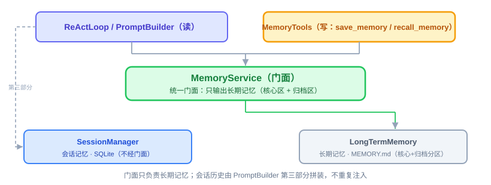

# Memory：实现与代码讲解

上一节评审定了方向，这节把它变成能跑的代码。照旧四件事：这节要实现什么、动手前该想清楚什么、代码怎么写、做完怎么验。

技术栈还是 JDK 21 + Spring Boot 3.x。工具一律实现 `OryxTool` 并在装配处显式登记，**不用 Spring AI 的 `@Tool` 注解自动注册**（原因在 Provider 那节讲过：自动执行的开关必须关掉，否则工具会被调两次）。下面的代码为了讲清结构做了简化，与仓库里的最终实现一一对应，实际签名以 `oryxos-memory` 为准。

---

## 一、这节要实现什么

一句话：**一个 `MemoryService` 门面，背后两条腿——会话记忆走 SQLite，长期记忆走一个分区的 `MEMORY.md`，外加两个内置 Tool 让 Agent 自己读写长期记忆。**

对照上一节的结论：接口先行、核心阶段文件式、三层记忆（核心/会话/归档）、写入靠 Agent 主动调 `save_memory`（不做自动提炼）。这节要交付的东西，就是把这几句话变成真实存在的类。



---

## 二、动手前先想清楚几件事

**第一，接口先行，跟上一节讲的"墙"一致。** `MemoryService` 的方法签名现在就定死：给 `PromptBuilder` 用的"要拼进 Prompt 的记忆内容"、给 `MemoryTools` 用的"记一条"和"查一下"。`ReActLoop`、`PromptBuilder` 全程只认这一个接口，不直接碰 `SessionManager` 或 `MEMORY.md` 文件。

**第二，核心记忆和归档记忆是同一个文件里的两个区块，不是两个子系统。** 用 Markdown 的二级标题分区就够——`## 核心记忆` 和 `## 归档记忆` 两个 header，读写的时候按区块处理。不需要为"核心记忆"单独开一张表或一个新类，那是过度设计。

`MEMORY.md` 内部长这样，一个文件、两个区块，读写规则完全不同：


**第三，几个坑，提前想到。**

- **坑一：不能缓存。** 上一节说过，`MEMORY.md` 每次重新读、不做缓存，这样 Agent 调完 `save_memory` 下一轮立刻能看到。这条写代码时最容易手滑加个缓存"优化性能"，一旦加了，"记完立刻生效"这个体验就没了，还得处理缓存失效，得不偿失。
- **坑二：截断只能裁归档区，不能连累核心区。** 长期记忆超过阈值（比如 4000 字）要截断，但**核心记忆是"永远完整、不换出"的**——如果截断逻辑简单粗暴地对整个文件掐头去尾，可能把核心记忆区截没了，这就违背了它"始终在场"的定位。截断必须只作用在归档区。
- **坑三：`save_memory` 写核心还是写归档，谁来决定。** 不能让系统自己猜，得让 Agent 显式说清楚——给这个 Tool 加一个可选参数（比如 `scope`，取值 `core` 或 `archival`，缺省 `archival`），Agent 调用时自己指定。
- **坑四：`recall_memory` 的检索不用做得多复杂。** 核心阶段就是简单的关键词包含匹配，按行或按块扫描归档区，命中就返回。别一上来就想上正则引擎或者分词，用不上。

想清楚这几点，代码该长什么样就清楚了：一个接口、一份分区的文件、不缓存、截断只裁一半、写入靠参数不靠猜。

---

## 三、代码怎么写

核心三个类：`MemoryService`（门面接口 + 实现）、`LongTermMemory`（长期记忆的文件读写）、`MemoryFiles`（路径 / 骨架 / 迁移的单一真身），外加 `MemoryTools` 把它们暴露给 Agent。

**第一步：`MemoryService` 接口。** 只对上层暴露两件事——要拼进 Prompt 的内容、记一条新的：

```java
public interface MemoryService {
    String buildContext(Session session);           // 给 PromptBuilder：核心记忆 + 会话历史
    void remember(String content, MemoryScope scope); // 给 MemoryTools：save_memory 调这个
    List<String> recall(String keyword);              // 给 MemoryTools：recall_memory 调这个
}

public enum MemoryScope { CORE, ARCHIVAL }
```

**第二步：`LongTermMemory`，长期记忆的核心实现。** 对外三个方法（第四件事"截断"不是对外 API，而是 `load()` 里的一步），内部按区块处理：

```java
public class LongTermMemory {

    private static final String CORE_HEADER = "## 核心记忆";
    private static final String ARCHIVE_HEADER = "## 归档记忆";
    private static final int MAX_ARCHIVE_CHARS = 4000;   // 阈值只管归档区

    private final Path memoryFile;
    private final Object writeLock = new Object();

    public void append(String content, MemoryScope scope) {
        MemoryScope target = scope == null ? MemoryScope.ARCHIVAL : scope;  // 缺省归档（坑三）
        String entry = render(content);              // "- [2026-10-19] 首行"，多行缩进续行
        synchronized (writeLock) {                   // "读-改-写"必须串行，否则并发写互相覆盖
            writeFile(insertEntry(readRaw(), target, entry));   // 定位区块、缺区块就补、插到区块末尾
        }
    }

    public String load() {
        String raw = readRaw();                      // 每次都重新读，坑一的解法；顺手去掉 UTF-8 BOM
        if (raw.isBlank()) {
            return "";                               // 文件没建过：这轮就是"没记起来"，不是错误
        }
        String core = section(raw, CORE_HEADER).strip();                 // 核心区：完整返回
        String archive = truncateArchive(section(raw, ARCHIVE_HEADER));  // 归档区：可能截断
        return core.isEmpty() ? archive : archive.isEmpty() ? core : core + "\n\n" + archive;
    }

    public List<String> recallByKeyword(String keyword) {
        if (keyword == null || keyword.isBlank()) {
            return List.of();                        // 空关键词不许退化成"把整个归档区倒出来"
        }
        String needle = keyword.strip().toLowerCase(Locale.ROOT);
        return section(readRaw(), ARCHIVE_HEADER).lines()
                .filter(line -> line.toLowerCase(Locale.ROOT).contains(needle))   // 简单包含匹配，坑四的解法
                .toList();
    }

    /** 只裁归档区这一段文本：物理上不可能动到核心区（坑二的解法），而且不写回磁盘。 */
    private String truncateArchive(String archive) {
        return archive.length() <= MAX_ARCHIVE_CHARS
                ? archive
                : archive.substring(archive.length() - MAX_ARCHIVE_CHARS);
    }
}
```

一行行看关键的几处：

- `append(content, scope)`——按 `scope` 决定写进哪个区块，核心记忆和归档记忆走同一个方法、同一份文件，只是目标区块不同。写入是"读-改-写"，所以用实例锁串行化：多个会话并发 `save_memory` 不会互相覆盖。
- `load()`——**每次都重新读文件，不做任何缓存**，对应坑一。核心区完整拿出来，只有归档区过 `truncateArchive`，对应坑二——截断函数只接收归档区这一段文本，物理上不可能动到核心区；而且截断只影响"注入上下文"，**不写回磁盘**，所以磁盘上的记忆永远只追加，谁也不会把 Agent 记下的东西悄悄删掉。
- `recallByKeyword(...)`——只在归档区里搜，核心记忆本来就永远在场，不需要"检索"这个动作。用 `String.lines().filter(...)` 这种最朴素的包含匹配，对应坑四；空关键词直接返回空列表，不许变成"倒出整个归档区"的旁路。
- **读取路径一律不抛异常**：文件缺失、区块缺失、路径其实是目录、IO 失败都按空记忆处理——读不到最多是"这轮没记起来"，不该拥有中断对话的否决权；写入失败则抛出去，由工具层转成失败的 `ToolResult`，让 Agent 知道"没记住"。

**第三步：`MemoryTools`，把长期记忆暴露给 Agent。**

```java
public final class MemoryTools {

    /** 写入：内容必填，scope 可选（core / archival，缺省 archival）。 */
    public static class SaveMemoryTool implements OryxTool {

        private final MemoryService memoryService;

        @Override
        public String getName() {
            return "save_memory";
        }

        @Override
        public String getDescription() {
            return "把需要跨会话长期记住的事写进记忆。scope 选 core（用户身份、项目背景、"
                    + "关键约束等每次都要带上的信息）或 archival（其余事实与历史），不确定就填 archival。";
        }

        @Override
        public String getInputSchema() {
            return "{\"type\":\"object\",\"properties\":{\"content\":{\"type\":\"string\"},"
                    + "\"scope\":{\"type\":\"string\",\"enum\":[\"core\",\"archival\"]}},"
                    + "\"required\":[\"content\"]}";
        }

        @Override
        public ToolResult execute(Map<String, Object> input) {
            String content = text(input, "content");
            if (content.isBlank()) {
                return ToolResult.fail("缺少 content 参数：要记住的内容不能为空", false);
            }
            MemoryScope scope;
            try {
                scope = parseScope(input.get("scope"));   // 缺省归档；非法取值直接拒绝（坑三的解法）
            } catch (IllegalArgumentException e) {
                return ToolResult.fail(e.getMessage(), false);
            }
            try {
                memoryService.remember(content, scope);
            } catch (RuntimeException e) {                        // 写盘失败：可重试
                return ToolResult.fail("写入记忆失败: " + e.getMessage(), true);
            }
            return ToolResult.ok("已记住（" + (scope == MemoryScope.CORE ? "核心记忆" : "归档记忆") + "）");
        }
    }

    /** 检索：只在归档区按关键词找，未命中返回提示而不是异常。 */
    public static class RecallMemoryTool implements OryxTool {

        private final MemoryService memoryService;

        @Override
        public String getName() {
            return "recall_memory";
        }

        @Override
        public String getDescription() {
            return "按关键词检索长期记忆的归档区（核心记忆每次都自动带上，不需要检索）。"
                    + "保存之前可以先查一下，避免重复记录。";
        }

        @Override
        public String getInputSchema() {
            return "{\"type\":\"object\",\"properties\":{\"keyword\":{\"type\":\"string\"}},"
                    + "\"required\":[\"keyword\"]}";
        }

        @Override
        public ToolResult execute(Map<String, Object> input) {
            String keyword = text(input, "keyword");
            if (keyword.isBlank()) {
                return ToolResult.fail("缺少 keyword 参数：检索关键词不能为空", false);
            }
            List<String> hits = memoryService.recall(keyword);
            return ToolResult.ok(hits.isEmpty() ? "没有找到相关记忆" : String.join("\n", hits));
        }
    }
}
```

`scope` 这个参数就是坑三的解法——**是不是核心记忆，由 Agent 自己判断，工具层不猜**。缺省给 `archival`（安全默认：写错地方最多多占点上下文），但给不出合法值时**直接失败**而不是静默改成归档：静默改写归属会让 Agent 以为写进了核心区而实际没有，比一条失败结果难查得多。

注意这里**没有用 `@Tool` 注解**，而是实现 `OryxTool`、在装配处显式登记进 `ToolRegistry`。原因在 Provider 那节讲过：Spring AI 的自动 tool 执行被显式关掉了（否则工具会被调两次），`@Tool` 在这条链路上只剩"生成 schema"的用处，而 `OryxTool.getInputSchema()` 已经把这件事做完。多留一条注解路径，只会让"到底谁在执行工具"变得含糊。工具归 Memory 能力、类留在 `oryxos-memory`，但执行时和其他内置工具完全一样地走 `ToolExecutor`，因此调用照常落 `tool_invocations` 审计。

**集成点：`PromptBuilder` 怎么用它。** 组装 Prompt 时多一步 `memoryService.buildContext(session)`，把返回值放进 `LlmRequest` 的**独立 memory 字段**（不是拼进 `systemPrompt` 字符串），由 Provider 层发请求时并进 system 消息——这跟 17 节讲的"四部分"对上了：第二部分就是它的真身。

**第二部分只放长期记忆，会话历史仍归第三部分。** 同一份内容注入两次，不但浪费 token，还会让模型看到重复的对话，所以门面刻意**不**输出会话历史（这一点和"统一门面"的说法不冲突：门面是长期记忆的唯一入口，会话记忆仍由 `SessionManager` 承担、由 `PromptBuilder` 直接取）。

**有几样先别做。** 语义检索、情景记忆、`save_memory` 的自动触发（上一节已经定了：核心阶段不做，等信号出现再说）、Memory Wiki 式的结构化矛盾检测、记忆压缩，这些都放扩展阶段。核心阶段做到"记得住、读得出、不会把核心记忆截没"就够。

坑一（不缓存）最值得单独验一遍，因为它是最容易被后来者"优化"掉的一条：


**本节交付物**（Spec-Kit 拆解锚点）：

- 代码：`MemoryService` 接口 + `DefaultMemoryService` 实现、`MemoryScope` 枚举、`LongTermMemory`（append / load / recallByKeyword）、`MemoryFiles`（路径 / 骨架 / 迁移的单一真身）、`MemoryTools`（save_memory / recall_memory）、`MemoryAutoConfiguration`（装配 + 工具登记）
- 接口归属：门面接口在 `oryxos-core`（`io.oryxos.core.memory`），实现在 `oryxos-memory`；引擎只依赖接口
- 测试：`LongTermMemoryTest`、`MemoryToolsTest`、`DefaultMemoryServiceTest`、`MemoryFilesTest`、`MemoryAutoConfigurationTest`（见验收 harness）
- 文件：`.oryxos/memory/MEMORY.md`（`## 核心记忆` / `## 归档记忆` 两区块约定），由 `oryxos init` 创建
- 集成点：`PromptBuilder` 组装时调 `memoryService.buildContext(session)`，结果放进 `LlmRequest.memory`

---

## 四、验收 harness：把验收标准变成可执行的测试

Memory 全是文件和内存操作，用 `@TempDir` 临时目录就能测干净，harness 全单测。四个坑各有一个回归测试钉死：

| 测试类 | 覆盖的验收点 |
|---|---|
| `LongTermMemoryTest` | **写后立读**（坑一：无缓存）；**截断只裁归档、核心区一字不动**（坑二）；截断不落盘；`scope` 路由到正确区块（坑三）；`recallByKeyword` 只搜归档区、空关键词不倒出全量（坑四附带）；多行内容不破区块结构；脏文件容错（缺区块 / 顺序颠倒 / 带 BOM）；并发写入不丢内容 |
| `MemoryToolsTest` | `scope` 缺省写归档、非法取值失败且不可重试；关键词未命中返回"没有找到相关记忆"而不是抛异常；缺参数失败；经 `ToolExecutor` 执行后落审计 |
| `DefaultMemoryServiceTest` | 门面**只输出长期记忆**（不重复会话历史）；记忆为空 / 路径异常时返回空串且不抛；写入后立即可见 |
| `MemoryFilesTest` | 初始化幂等；迁移四场景（无遗留 / 无有效内容 / 迁移并备份 / 目标已有内容跳过）；带 BOM 的遗留文件不把标题当条目 |
| `MemoryAutoConfigurationTest` | 两个工具进了共享注册表；记忆路径落在 `memory/MEMORY.md`；装配不越权创建文件 |

两个最值钱的：

```java
@Test
void 截断只裁归档区_核心记忆一字不能少() {
    memory.append("用户叫小王，偏好用 Java", MemoryScope.CORE);
    for (int i = 0; i < 500; i++) {
        memory.append("归档流水 " + i, MemoryScope.ARCHIVAL);   // 把归档区灌到远超 4000 字
    }

    String loaded = memory.load();

    assertTrue(loaded.contains("用户叫小王，偏好用 Java"));   // 核心区完整——"始终在场"的底线
    assertFalse(loaded.contains("归档流水 0"));               // 归档区最早的内容被裁掉了
    assertTrue(loaded.contains("归档流水 499"));              // 保留的是最近的
}

@Test
void 写入后立刻可读_不允许有缓存() {
    memory.append("刚记的事", MemoryScope.ARCHIVAL);
    assertTrue(memory.load().contains("刚记的事"));           // 同一进程内下一次 load 立即可见
    assertFalse(memory.recallByKeyword("刚记的事").isEmpty()); // 检索同样立即命中
}
```

第一个测试是这节最重要的一道保险：截断逻辑将来任何"优化"（比如有人改成对全文件掐头去尾），这里立刻红。

---

## 五、做完怎么验

harness 全绿后，剩下的人工确认：

- 用真模型完整走一遍：对话里说一句值得记的话，Agent 主动调 `save_memory`；开新会话，系统提示里带着核心记忆——"始终在场"在真实链路里的体感。
- 跨进程验证：重启后 `MEMORY.md` 里的记忆还在（文件天然跨重启，目检一眼）。
- `MEMORY.md` 和 `USER.md` 的角色分清：`USER.md` 全程只读、`MEMORY.md` 能被 Agent 写入（code review 确认没有写 USER.md 的代码路径）。
- 无缓存、截断保核心、scope 路由、未命中不报错——已由 harness 覆盖，`mvn test` 绿即打勾。

到这一步，Agent 不但会想（ReAct）、会动手（Tool），还记得住事（Memory）——三大能力凑齐了。Demo 二（跨对话记偏好）本身就是这节的能力：说一句偏好，`save_memory` 写进文件，重启后新会话组装 Prompt 时自动带上，用户不用重述；Demo 三（零代码 PR digest）里"日报要体现用户之前说过的偏好"这一环，靠的也是这里。

**实现说明（已交付）**：这节的能力已按 `specs/006-memory/` 落地，与上面示意代码相比有四处值得注意的差异：

1. **门面接口在 core**：`io.oryxos.core.memory.MemoryService`，实现 `DefaultMemoryService` 在 `oryxos-memory`——引擎不能反向依赖实现模块，这与 `SessionStore`↔`JpaSessionStore` 是同一套路。
2. **文件格式单点定义**：路径、骨架、两个区块标题、迁移逻辑都在 `MemoryFiles`，`oryxos init` 与运行时共用，避免"两处各写一遍格式"的漂移。
3. **容错比示意代码多两处**：读取时去掉 UTF-8 BOM（记事本/PowerShell 写出的文件常带 BOM，不去掉会把首行标题判成一条记忆——这条是端到端跑真实产物时踩出来的）；区块边界按"行首 `## `"判定，写入内容里的 `## ` 因缩进续行而不构成新区块。
4. **测试规模**：五个测试类共 43 条单测（`LongTermMemoryTest` 18 / `MemoryToolsTest` 8 / `DefaultMemoryServiceTest` 7 / `MemoryFilesTest` 8 / `MemoryAutoConfigurationTest` 2），`mvn test` 全量绿；另已用真实模型跑通跨会话记偏好（核心区一条约束 + 归档区两条事实）。
