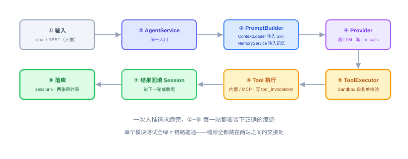
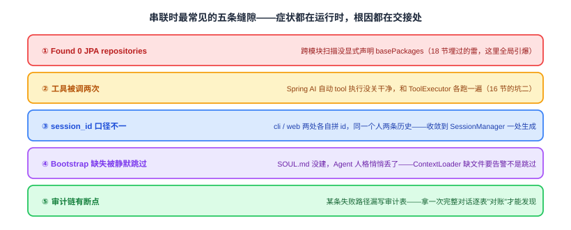

# 全链路串联：实现与代码讲解

上一节把 Web Service 立起来了，五大核心能力都有了对外出口。但"模块都在"和"链路能跑"是两件事——前面每一节的测试都在打桩，把邻居换成 mock，所以每站自己都站得住，站与站之间的接线却从没被真跑过。这节不造新能力，只做一件事：**把八站接成一条路，并把接缝上的五处漏水堵上**。照旧四件事：是什么、动手前想清楚什么、代码怎么写、做完怎么验。

技术栈不变，命令还是 `oryxos chat` / `oryxos serve`。下面的代码取自仓库实际实现，文件位置见文末附录。

---

## 一、全链路串联是什么，干嘛用的

一句话：**串联不是写新功能，是把两个相邻模块之间的交接处逐一换成真的，并验证交接处没漏东西。**

一次人工请求从进门到落库，会经过八个站点：



| # | 站点 | 这一站负责什么 | 留下的痕迹 |
|---|---|---|---|
| ① | 输入 | `oryxos chat` 或 `POST /sessions/{id}/messages` | 无（内存里的消息） |
| ② | `AgentService.process` | 统一入口，生成 `runId`，跑完写 `agent_runs` | 一行 `agent_runs` |
| ③ | `PromptBuilder` | `ContextLoader` 注入 Bootstrap + SKILL、`MemoryService` 注入长期记忆、`SessionManager` 提供会话历史 | 拼出的 prompt（不落库） |
| ④ | `Provider` | 翻译成各家协议、真调模型 | 一行 `llm_calls`（成功/失败都写） |
| ⑤ | `ToolExecutor` | 防呆、授权、`Sandbox` 白名单校验 | ——（校验失败也在⑥记） |
| ⑥ | Tool 执行 | 内置 Tool / MCP，结果回填后回到④再问一轮 | 一行 `tool_invocations` |
| ⑦ | 回填 Session | assistant 消息、tool 消息进历史 | 内存 + `sessions` 表 |
| ⑧ | 落库 | `sessions`、`llm_calls`、`tool_invocations`、`agent_runs` | 四张表 |

关键洞察在图的底部：**单个模块测试全绿 ≠ 链路能跑通**。缝隙全在两站之间的交接处——而这些交接处正是 mock 掉的地方。

所以这节的交付物不是"新的能力模块"，只有三样：

1. **五处修复**（真代码改动，见第三节）；
2. **四层 harness**（装配层 / 开关层 / 链路层 / 对账层，见第四节）；
3. **一条可复现的手工剧本**（人能照着走一遍，见第五节）。

这三样加起来才叫"串联完成"。只跑通一次不算——那叫"碰巧通了"。

---

## 二、动手前先想清楚几件事

**第一，顺序必须一层一层加真变量，不能一次全真。** 一次让所有东西都变成真的，挂了之后你无法判断是哪一站的问题。推荐这个顺序，每一步只引入一个新变量：

```
Provider 单点真调 → ReAct 单工具 → Memory 跨轮 → Sandbox 拦截 → 换入口（CLI→Web） → 定时触发
```

`ReactLoopSmokeIT` 就是这个思路的范本：**模型是真的，工具是假的**（本地塞一个 `get_weather`），一次只让"模型"这一件事真起来，工具的行为完全可控。

**第二，串联的产物是"换桩"，不是"多写测试"。** 每节自己的单测都用 mock 扮演邻居；串联测试要做的是把 mock 换成真实现。所以串联的价值不体现在新增测试数量上，而体现在**删掉了多少个 mock**。

**第三，失败时必须能定位到站。** 八站各有独立痕迹：`runId` 串起一次请求、`sessionId` 串起一段对话、四张表各自记账。链路出问题，第一动作是查表对账，不是翻日志——**审计表就是这条链路的黑匣子**。

**第四，串联阶段允许也必须回过头改前面的代码。** 缝隙只能在真链路上暴露，这是绕不过去的规律。但改完必须回补对应的单测，不能"链路通了、单测松了"——那样下次改坏就没人拦。

**第五，别在这节顺手加功能。** 串联节最大的风险是修着修着开始"顺便把 XX 也做了"，最后什么也没验完。发现的新需求记下来，归到后面的节。

---

## 三、代码怎么写

这一节的"写代码"分两半：先按五条已知缝隙改代码，再按接线顺序把它们串起来。



### 缝隙①：`Found 0 JPA repositories`

**症状**：各模块单测全绿，一 `serve` 就起不来，堆栈里一句 `Found 0 JPA repositories`。

**根因**：普通 `@Component` 靠主类所在包（`io.oryxos`）隐式扫描，覆盖所有子模块没问题；但 `@Entity` 和 `Repository` 走的是 JPA 自己那套查找机制，在多模块 + 依赖 jar 的场景里拿不到正确包，于是扫出 0 个。

**修法**：显式声明，不靠推断。

```java
@SpringBootApplication
@EnableJpaRepositories(basePackages = "io.oryxos.storage.repository")
@EntityScan(basePackages = "io.oryxos.storage.entity")
public class OryxosApplication {
}
```

这两行是"跨模块"的显式契约：Boot 的组件扫描认根包，JPA 的两个扫描器不认，必须自己喂包名。切片测试（`@DataJpaTest`）里也要重复声明同样两个 basePackages——它另起一套上下文，不会继承主类的注解。

### 缝隙②：工具被调两次

**症状**：日志里同一个工具出现两遍，`tool_invocations` 两行，模型拿到两份结果后开始自相矛盾。

**根因**：Spring AI 的 `ToolCallingChatOptions` 默认**会自己执行** toolCallback 并再发一轮请求；而我们的 `ReActLoop` + `ToolExecutor` 也在执行。两套循环各跑一遍，工具就被调了两次。

**修法**：在构造请求的唯一位置关掉它。

```java
ToolCallingChatOptions.Builder optionsBuilder = ToolCallingChatOptions.builder()
        // 关键：关闭 Spring AI 的自动工具执行
        .internalToolExecutionEnabled(false);
if (provider.getModel() != null && !provider.getModel().isBlank()) {
    optionsBuilder.model(provider.getModel());
}
...
if (toolCallbacks != null && !toolCallbacks.isEmpty()) {
    optionsBuilder.toolCallbacks(toolCallbacks);   // 传：为了拿 schema；执行权归 ReActLoop
}
```

注意 `toolCallbacks` 仍然要传——不传就拿不到 function schema，模型不知道有哪些工具。**传进去是"告诉模型有什么"，关掉自动执行是"告诉框架别动手"**，这两件事必须同时做，这是宪法原则 4 最容易被写错的地方。

全仓库只有这一个开关位，所以它必须被一个测试钉住（见第四节"开关层"）。

### 缝隙③：`session_id` 口径不一致

**症状**：CLI 里聊过的会话，Web 上查不到；或者同一个人莫名其妙有两条历史。

**根因**：id 在多处各自拼。CLI 拼一个、Web 拼一个，`channel` / `userId` 也对不上。

**修法**：生成点收敛到一处——`SessionManager`。

```java
/** 按业务身份幂等获取活动会话。 */
public Session getOrCreate(String channel, String userId, String profileName) {
    String identity = identityKey(channel, userId, profileName);
    // ① 内存命中直接返回
    // ② 加锁后二次检查
    // ③ 查库：findByIdentity(...).filter(非 archived)
    // ④ 都没有才创建，且只有这里生成 id
    Session created = create(UUID.randomUUID().toString(), profileName, channel, userId);
    ...
}

/** 兼容旧调用方，参数顺序为 profile、channel、user。 */
public Session create(String profileName, String channel, String userId) {
    return create(UUID.randomUUID().toString(), profileName, channel, userId);
}
```

三个入口的用法各自明确：

- CLI：`sessionManager.getOrCreate("cli", "local", profileName)` —— 同一个 profile 反复进来是同一段对话；
- Web 续聊：调用方给了 id 就 `get(id)`（不存在 → 404），没给就 `getOrCreate("web", userId, profile)`；
- Web 一次性：`create(name, "invoke", userId)` —— 每次独立，不污染任何人的连续会话。

**这里有个必须讲清的误解**：幂等键是 `(channel, userId, profileName)` 三元组，**`channel` 在里面**。所以 CLI 和 Web 天然是两段独立会话流——这是对的，各自保持连续性。想让两个入口看到同一段历史，唯一办法是**把那个 `sessionId` 显式传过去**（`GET /sessions/{id}`），而不是指望 `getOrCreate` 自动合并。

所以"两个入口共享"实际要满足两个条件：**同一个 db 文件** + **同一个 sessionId**。前者靠配置，后者靠上面这条收敛。缺任何一个，症状都是"CLI 能查、Web 查不到"。

### 缝隙④：Bootstrap 缺失被静默跳过

**症状**：Agent 说话风格突然变了，人格设定和约束全没了，但启动日志里没有错误、接口也没报错。

**根因**：`ContextLoader` 在"默认三件套"模式下，文件不存在就 `continue`。只有一行 `warn`，混在启动日志里根本看不见。

**修法**：把"缺失"分成两种语义，用 Profile 是否显式引用作为判据。

```java
for (String name : targets) {
    Path file = resolveWorkspacePath(name);
    if (!Files.isRegularFile(file)) {
        if (explicitMode) {
            throw new ContextLoadException(
                    "Bootstrap 文件不存在: " + file + "（Profile 的 bootstrap.files 显式引用）");
        }
        logger.warn("默认 Bootstrap 文件缺失，跳过: {}", file);
        continue;
    }
    addIfPresent(sections, readFile(file));   // 每次重新读，不缓存
}
```

判据很简单：**Profile 里写了 `bootstrap.files`，就是"我要它"，缺了必须炸；没写就是"有就用"，缺了只是能力降级**。默认三件套是 `AGENTS.md` / `SOUL.md` / `USER.md`；SKILL.md 被 Skill 显式引用，缺失同样抛异常——不属于"可选降级"。

### 缝隙⑤：审计链有断点

**症状**：功能看着全对，但某条失败路径没写审计。事后排查"这次到底调了没调、花了多少、为什么失败"，查不到。

**根因**：审计写在"成功之后"。异常一抛，后面的 `record` 就跳过去了。

**修法**：审计点放在**唯一的收口处**，成功失败都从它过。

`tool_invocations` 的收口是 `ToolExecutor.auditAndReturn(...)`，四条路径全覆盖——工具不存在、前置校验失败、工具抛异常、正常返回：

```java
try {
    auditor.record(sessionId, profileName, toolName, parameters,
            result.isSuccess(), result.getError(), result.getContent(), latencyMs);
} catch (RuntimeException e) {
    logger.error("工具审计写入失败（已忽略，不影响本次调用）: tool={}, error={}",
            toolName, e.getMessage(), e);
}
return result;
```

`llm_calls` 的收口是 `DefaultProviderService.chat()` 的两条分支：

```java
auditor.record(sessionId, providerName, modelName, llmResponse.usage(), true, null, latencyMs);
return llmResponse;
} catch (RuntimeException e) {
    ...
    // 失败也留痕，再把异常抛给上层处理
    auditor.record(sessionId, providerName, modelName, null, false, e.getMessage(), latencyMs);
    throw e;
}
```

两个细节值得说：

- **审计写失败不能阻断主流程**（catch 掉打 ERROR）。审计是"必须尝试"，不是"必须成功"——为了记不上账而让用户这次对话失败，本末倒置。
- **失败也要留一行**。没有失败记录，"模型没响应"和"根本没调模型"这两件事就分不开，排障时会白走很远。

请求级的失败还有第四张表兜底：`AgentService` 在 `TIMEOUT` / `MODEL_ERROR` / `INTERNAL_ERROR` 三种结局都调 `finished(...)` 写 `agent_runs`，所以超时也是有账的——每次 LLM 调用已各自落库，请求级超时只是额外补一条总账。

### 接线：按顺序把八站串起来

改完五处，按第二节的顺序逐层验证。每层都建议用"最小 Profile"：

```yaml
name: smoke
provider:
  name: deepseek
  model: deepseek-chat
tools: [get_weather]
settings:
  maxIterations: 5
```

1. **只开 Provider**：一个不带工具、不带记忆的 Profile，单轮真调。通了说明②③④和 `llm_calls` 都在。
2. **加一个假工具**：照 `ReactLoopSmokeIT` 的范式，工具自己实现、行为可控。通了说明⑤⑥和 `tool_invocations` 都在。
3. **加 Memory**：两轮对话，第二轮能引用第一轮的事实。通了说明③的 `MemoryService` 注入是真的。
4. **加 Sandbox**：故意越界一次（读白名单外的路径），确认被拦、且 `tool_invocations` 里有一行失败。
5. **换入口**：CLI 里跑一轮，拿 `sessionId` 去 `GET /api/v1/sessions/{id}` 查同一段历史。
6. **加调度**：定时任务触发一次，看 `agent_runs` 多一行、通知发出去了。

**本节交付物**（无独立 spec，作为 16~26 节的收口验证）：

- 修复：`OryxosApplication` 显式 JPA 扫描、`internalToolExecutionEnabled(false)`、`sessionId` 收敛、Bootstrap 双策略、审计收口
- 测试：`WebSmokeTest`（装配层）、`ReactLoopSmokeIT`（链路层）、`ReactLoopRealRunIT`（对账层）、`ProviderServiceTest`（开关层）
- 剧本：一条可复现的手工全链路记录（含四表对账数字）

---

## 四、验收 harness：把验收标准变成可执行的测试

串联的 harness 分四层，从便宜到贵。前两层每次构建都跑，后两层发版前手动跑。

| 层 | 测试类 | 真什么 / 假什么 | 覆盖的验收点 |
|---|---|---|---|
| 装配层 | `WebSmokeTest`（`oryxos-boot`） | 真 Spring 上下文 + 随机端口；模型不参与 | `/health`=UP、`/info` 带 provider 与 sandbox、`/tools` 含内置工具（证明 Bean 扫描与 `ToolRegistry` 装配）、`/admin` 被托管、未知 Agent → 404 `PROFILE_NOT_FOUND` |
| 开关层 | `ProviderServiceTest` | mock `ChatModel`，捕获真实 Prompt | `internalToolExecutionEnabled` 必须是 `false`，且 `toolCallbacks` 仍在（schema 不能丢） |
| 链路层 | `ReactLoopSmokeIT` | 真模型；本地假 `get_weather` | 工具被调用、历史里有 `[Tool Request]` 的 assistant 消息、tool 消息含结果、最终答复干净不带工具请求 |
| 对账层 | `ReactLoopRealRunIT` | 全真，写真实 `.oryxos/oryxos.db` | `llm_calls` 有 success 记录、`tool_invocations` 有该工具且 success —— 拿"表里有账"当链路通过的证据 |

**最值钱的是开关层**，因为它守的是宪法原则 4，而且是那种"改一行就悄悄回退"的地方：

```java
ArgumentCaptor<Prompt> captor = ArgumentCaptor.forClass(Prompt.class);
verify(deepseek).call(captor.capture());

ChatOptions options = captor.getValue().getOptions();
assertFalse(ToolCallingChatOptions.isInternalToolExecutionEnabled(options),
        "Spring AI 自动工具执行必须被关闭");
ToolCallingChatOptions toolOptions = (ToolCallingChatOptions) options;
assertThat(toolOptions.getToolCallbacks()).hasSize(1);   // schema 还得在
assertThat(toolOptions.getToolCallbacks().get(0).getToolDefinition().name()).isEqualTo("http_get");
```

它同时钉住两个方向：关掉自动执行（否则工具调两次）、保留 callbacks（否则模型不知道有工具）。少断言任何一个，缝隙②都可能悄悄回来。

**对账层的写法**值得单独说：不新写断言逻辑，直接查表。

```java
assertThat(llmCallRepository.findBySessionId(sessionId))
        .anyMatch(call -> Boolean.TRUE.equals(call.getSuccess()));
assertThat(toolInvocationRepository.findBySessionId(sessionId))
        .anyMatch(inv -> "get_weather".equals(inv.getToolName())
                && Boolean.TRUE.equals(inv.getSuccess()));
```

这就是第三节说的"审计表是黑匣子"在测试里的用法——**链路对不对，用账本说话**。

**关于 `*IT` 的执行**：父 POM 没配 failsafe，`mvn test` 不会跑 `*IT`。所以：

```bash
# 装配层 + 开关层：每次构建都跑
mvn test

# 链路层 + 对账层：发版前手动跑（要真 key、要真网、要花钱）
mvn -pl oryxos-boot -am test -Dtest=ReactLoopSmokeIT -DfailIfNoTests=false
mvn -pl oryxos-boot -am test -Dtest=ReactLoopRealRunIT -DfailIfNoTests=false
```

`-DfailIfNoTests=false` 不能省：`-am` 会把上游模块一起带上，那些模块里没有这个类，不加参数会直接 "No tests were executed" 报错。

还有一条纪律：**这几个 IT 不进 CI**。要密钥、要外网、结果不稳定，进 CI 只会让人习惯性忽略红叉。

---

## 五、怎么用，做完怎么验

先跑自动化，再走手工剧本。

```bash
oryxos init                                        # 建 .oryxos/、默认 Profile
oryxos chat default                                # 第一轮：纯对话
# 第二轮：说一句能触发工具的话，看是否真的调了工具

oryxos serve                                       # 另一个终端
sqlite3 .oryxos/oryxos.db "select session_id, channel from sessions;"
curl localhost:8080/api/v1/sessions/{cli-session-id}   # 能查到 CLI 那段历史 → 缝隙③过关
```

然后对账——**这一步不能用"看起来正常"代替**：

```bash
sqlite3 .oryxos/oryxos.db \
  "select count(*) from llm_calls;
   select count(*) from tool_invocations;
   select status, stop_reason, success from agent_runs order by started_at desc limit 5;"
```

数字要自洽：`llm_calls` 的行数 ≥ ReAct 轮数、`tool_invocations` 里**没有重复行**（缝隙②）、每次请求在 `agent_runs` 里一行且 `status` 收尾为 `FINISHED`，`stop_reason` 给出结局（`FINAL_ANSWER` / `MAX_ITERATIONS` / `TIMEOUT` / `MODEL_ERROR` / `INTERNAL_ERROR`）——`status` 只有 `RUNNING`/`FINISHED` 两种，别把两者搞混。

自动化替代不了的人工确认：

- 五条业务流各跑一遍：查天气（Provider + ReAct）、跨对话记偏好（Memory）、越界读文件被拦（Sandbox）、定时任务到点触发（Scheduler）、CLI 与 Web 看同一段历史（Web）。
- 断网跑一次：模型调用失败，`llm_calls` 仍有一行 `success=false` 且带 `error_message`（缝隙⑤）。
- 删掉 `SOUL.md` 重启：默认模式下只有一行 warn、照常启动；Profile 里显式写了 `bootstrap.files` 的则启动失败（缝隙④）。
- 把 `spring.datasource.url` 指到别的文件再起：会话查不到——确认"共享"靠的是同一个 db，不是幻觉。

到这一步，**人推的链路从入口到落库已经通了**。但 OryxOS 还有另一种跑法：没人推、钟来推——定时任务触发，跑完自己把结果推出去。那条链路的头和尾都不一样，中间却应该一模一样。这是下一节的正题。

---

## 附：仓库实现说明

这一节没有独立的 spec 目录（`specs/` 下 001~009 都是按能力切的），串联验证散落在各 spec 落地的集成测试里。与示意内容的差异：

| # | 示意 | 仓库实现 | 说明 |
|---|---|---|---|
| 1 | 三张表（`sessions` + 两张审计） | **四张**：多一张 `agent_runs` | 请求级总账，串联对账时最有用：`status` 说"跑没跑完"，`stop_reason` 说"怎么结束的" |
| 2 | 审计"两张表" | 一致（`llm_calls`、`tool_invocations`），另加 `agent_runs` | 图注沿用"两张审计表"，实指能力级审计；请求级另记 |
| 3 | 开关测试类名 `ProviderServiceLlmClientTest` | 实际在 `ProviderServiceTest` | 断言内容一致：`internalToolExecutionEnabled=false` + callbacks 保留 |
| 4 | 链路层 `*IT` 直接跑 | `AskAiIT`、`ReactLoopSmokeIT`、`ReactLoopRealRunIT` 三个 | 分别覆盖"纯模型"、"模型 + 假工具"、"模型 + 真库对账" |
| 5 | CLI 端到端自动化 | **未落地**（`003-cli` 的 T052 `CliEndToEndTest` 未实现） | 目前靠真实进程手工验证；这是已知缺口，不假装有 |
| 6 | `sessionId` 幂等 | 键是 `(channel, userId, profileName)` 三元组，且过滤 `archived` | 比"按人找最近会话"更严格：跨渠道不会串台 |
| 7 | Bootstrap 双策略 | 与示意一致 | 默认三件套 `AGENTS.md`/`SOUL.md`/`USER.md`；SKILL.md 缺失一律抛异常 |
| 8 | 审计失败不阻断 | 与示意一致，审计器自身 `catch (RuntimeException)` 打 ERROR | `JpaLlmCallAuditor` / `JpaToolInvocationAuditor` 都这样处理 |

现有可直接复用的链路测试清单：

- `oryxos-boot`：`WebSmokeTest`（装配 + `/admin` 托管）、`AskAiIT`（纯模型真调）、`ReactLoopSmokeIT`（假工具真模型）、`ReactLoopRealRunIT`（真库对账）、`SpringRuntimeLauncherTest`（`chatChannel()` 复用注入的 `AgentService` / `SessionManager`）
- `oryxos-core`：`ReActLoopTest`、`ReActLoopToolAuthorizationTest`、`ToolExecutorTest`、`AgentServiceTest`、`SessionManagerTest`、`ContextLoaderTest`
- `oryxos-provider`：`ProviderServiceTest`（开关层）、`ProviderSmokeIT`（RecordingAuditor 验审计）
- `oryxos-storage`：`JpaSessionStoreTest`、`LlmCallRepositoryTest`、`ToolInvocationRepositoryTest`、`AgentRunRepositoryTest`（`flush + clear` 走真实 SQLite 往返）
- `oryxos-web`：`SessionApiControllerTest`、`AgentInvokeTest`、`ToolApiControllerTest`、`GlobalExceptionHandlerTest`

约束原文见 `AGENTS.md` 第 3 节原则 4（Spring AI 只用一半）与原则 6（审计 day one 落库）；这两条正是本节五条缝隙里②和⑤守的东西。
